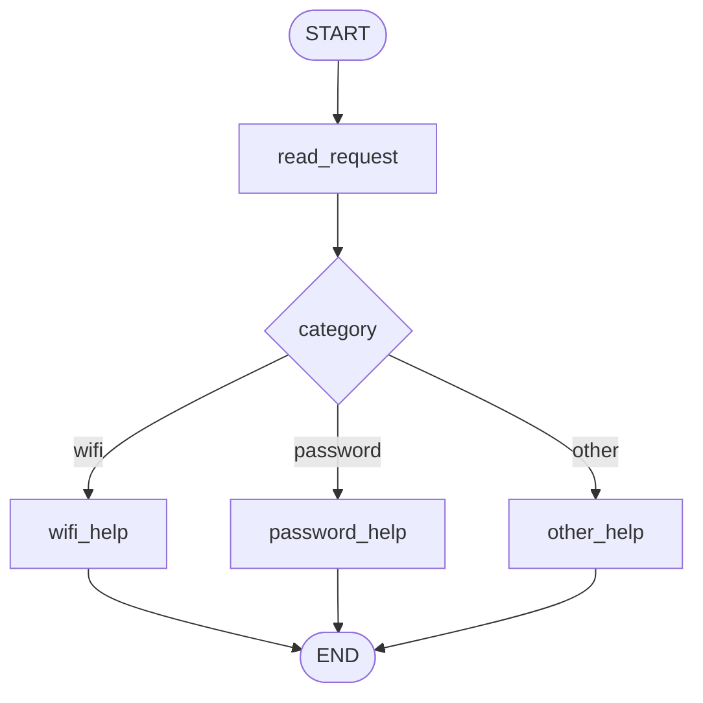
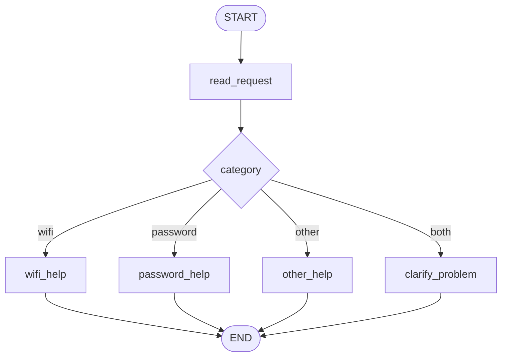
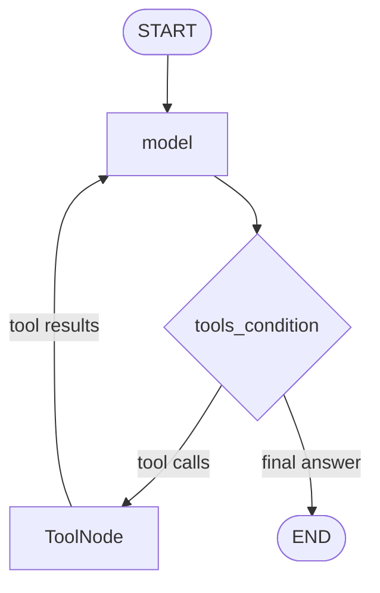

# HW5 — My LangGraph Helpdesk

**Student:** Sofiya Serbina  
**Course:** CSS-4007 — Artificial Intelligence  
**Model/provider:** `gpt-4o-mini` / OpenAI  
**Runtime:** Python 3.9, LangGraph, SQLite

## Part 1 — How the Graph Works

### 1.1 Original Graph and State

I first implemented a deterministic helpdesk graph without a language model.



The graph uses a shared `HelpdeskState` with three fields:

| Field | Purpose |
| --- | --- |
| `message` | Original user message |
| `category` | Identified problem category |
| `reply` | Response generated by a help node |

The `read_request` node reads the original message, identifies the category using fixed Python rules and returns a state update.

The help nodes read the relevant instructions from `data/helpdesk.json` and generate a response.

The conditional router `choose_next_node` reads the category and determines the next node.

### 1.2 State and Graph Questions

**1. What does each node read and change?**

`read_request` reads `message` and updates `category`.

`wifi_help` and `password_help` read the corresponding local instructions and update `reply`.

`other_help` updates `reply` with a clarification question.

The router reads `category`, but does not modify the state.

**2. What is the difference between a node update and a conditional edge?**

A node returns changes to the graph state.

A conditional edge determines which node executes next.

Therefore, state updates control the data, while conditional edges control execution flow.

**3. What state does the next node receive?**

The next node receives the current merged graph state, not only the update returned by the previous node.

For example, `wifi_help` can access the original `message` even though `read_request` returned only `category`.

**4. What do START, END and compile mean?**

`START` represents the graph entry point.

`END` represents successful termination.

`compile()` prepares the defined graph for execution by validating its structure and creating an executable graph.

### 1.3 Predictions and Actual Results

Before executing the original graph, I predicted the following routes.

| Scenario | Message | Predicted route | Actual route |
| --- | --- | --- | --- |
| S01 | `I cannot connect to Wi-Fi.` | `read_request → wifi_help` | Same |
| S02 | `I forgot my PASSWORD.` | `read_request → password_help` | Same |
| S03 | `My laptop screen is broken.` | `read_request → other_help` | Same |
| S04 | `My Wi-Fi password does not work.` | `read_request → wifi_help` | Same |

All four predictions matched the actual execution traces.

For S01, the `read_request` node changed `category` from an empty string to `wifi`. The `wifi_help` node then returned the instructions from `GUIDE-WIFI`.

For S02, uppercase `PASSWORD` was recognized because the input was converted to lowercase before classification.

For S03, no supported keyword was found, so the graph returned a clarification question.

For S04, the message contained both Wi-Fi and password. The original graph selected Wi-Fi because the Wi-Fi condition was checked first.

The original routing rules therefore have explicit priority.

The actual node order, state updates and state after each node are stored in `outputs/S01_part1.json` through `outputs/S04_part1.json`.

### 1.4 Modified Graph

I added a new node called `clarify_problem` to handle messages mentioning both topics.



The revised graph checks whether both topic keywords are present before applying the individual routing rules.

When both are detected, the category becomes `both`.

In S05, the actual route was:

```text
START → read_request → clarify_problem → END
```

The response asked which problem the user wanted to solve first.

This changes the graph's actual execution path instead of only changing the response text.

The trace is saved in `outputs/S05_part1.json`.

### 1.5 What LangGraph Controls

LangGraph manages graph execution, state propagation and transitions between nodes.

My Python functions determine categories, apply keyword rules and retrieve the appropriate instructions.

There is no LLM involved in Part 1.

This demonstrates the separation between workflow orchestration and application-specific decision logic.

---

## Part 2 — Model and Tools

### 2.1 Reusable Tools

I extended the helpdesk with three local tools implemented in `helpdesk_tools.py`.

| Tool | Function | Data source |
| --- | --- | --- |
| `find_instructions` | Retrieves Wi-Fi or password instructions | `helpdesk.json` |
| `check_service_status` | Returns a simulated service status | `helpdesk.json`, `service_status.json` |
| `prepare_ticket` | Validates and saves a local support ticket draft | `ticket_template.json` |

All three tools can be called directly without the agent.

I verified this using `test_tools_manual.py`.

The direct checks confirmed:

- Wi-Fi instructions return `GUIDE-WIFI`.
- Password instructions return `GUIDE-PASSWORD`.
- Wi-Fi status profiles return `operational`, `outage` or `unknown`.
- Password recovery maps to the `account_recovery` service.
- Missing ticket information prevents draft creation.
- A valid ticket is saved locally as a JSON file.

The local tools do not communicate with any real university service.

### 2.2 Model and Tool Execution Graph

The model is connected to the tools through LangGraph.



The `model` node calls `gpt-4o-mini`.

The model may request one of the available tools.

The `tools_condition` function checks whether the model returned tool calls.

If tools are requested, LangGraph routes execution to `ToolNode`.

After execution, the tool results are added to the messages and returned to the model.

The loop continues until the model produces a final answer without requesting another tool.

### 2.3 Model and Tool Questions

**1. How does the graph decide between running a tool and ending with an answer?**

The graph uses `tools_condition`.

If the model response contains tool calls, the graph executes the `tools` node.

If there are no tool calls, execution goes to `END`.

**2. Which component requests and executes a tool?**

The LLM requests a tool by generating its name and arguments.

The LangGraph `ToolNode` executes the corresponding Python wrapper.

The wrapper calls the local Python tool implementation.

The model cannot directly execute Python code.

**3. What changes in the state after a tool result returns?**

The tool response is added to `MessagesState.messages` as a `ToolMessage`.

The next model invocation receives the previous messages and the new tool result.

This allows the model to make a decision based on retrieved information.

**4. What makes Part 2 different from Part 1?**

In Part 1, fixed Python rules determine routing.

In Part 2, the language model chooses which tool to request based on the user's message and previous tool outputs.

LangGraph still controls the execution workflow.

### 2.4 Loop Limit

I configured a recursion limit of 15 graph steps.

```python
MAX_GRAPH_STEPS = 15
```

The limit is supplied to `graph.stream()` through the execution configuration.

If the graph exceeds this limit, LangGraph raises `GraphRecursionError`.

The runner catches this exception and records `loop_limit_reached`.

I also configured sequential tool calls using:

```python
parallel_tool_calls=False
```

This allows the model to receive a service-status result before deciding whether to prepare a conditional ticket.

### 2.5 Real Model Demonstration — S06

Model: `gpt-4o-mini`  
Provider: OpenAI  
Service profile: `normal`

The user first requested Wi-Fi troubleshooting instructions.

The model called:

```text
find_instructions(topic="wifi")
```

The tool returned `GUIDE-WIFI` and the supplied troubleshooting steps.

The user then reported that Wi-Fi still did not work and requested a service-status check.

The model called:

```text
check_service_status(topic="wifi")
```

The tool returned:

```text
status = operational
```

Since the service was operational and the user requested a conditional ticket, the model called:

```text
prepare_ticket(...)
```

The tool returned `ok: true` and saved a local draft.

In the successful recorded run, the draft ID was:

```text
DRAFT-a7c1b5db1d60
```

The assistant explained that the draft had been saved locally and had not been submitted.

The complete model requests, tool responses and final answer are stored in `outputs/S06_part2.json`.

### 2.6 Conditional Behavior

The supplied service-status snapshots were used to test different outcomes.

| Scenario | Status profile | Actual behavior |
| --- | --- | --- |
| S06 | `normal` | Wi-Fi operational; a local ticket draft was created |
| S07 | `wifi_outage` | Wi-Fi outage reported; conditional draft not created |
| S08 | `status_unavailable` | Status unknown; conditional draft not created |
| S09 | `normal` | Missing details requested; draft created after clarification |
| S14 | `recovery_outage` | Account recovery outage detected and explained |

These demonstrations show that the same conditional request can lead to different behavior depending on the tool result.

The model is not allowed to assume that `unknown` means `operational`.

For S14, the agent correctly checked `account_recovery` rather than Wi-Fi.

### 2.7 Improvements During Development

The initial S06 execution exposed two tool-call issues.

The model passed `Wi-Fi troubleshooting` as a topic, which the initial normalizer did not recognize.

The model also omitted the required ticket category.

I improved topic normalization and allowed the application to infer the ticket category from the current problem and checked service.

During S09, an additional exact-string validator rejected a correct paraphrase of the user's actions. I removed that overly strict validation and retained instructions requiring the model to use only actions actually mentioned by the user.

I also added a check preventing unsolicited ticket creation.

The corrected S06 and S09 runs successfully created local drafts.

---

## Part 3 — Persistent Memory

### 3.1 Two Types of Memory

I implemented two separate types of memory.

**Conversation memory** stores messages and context belonging to a specific conversation.

It uses the LangGraph `SqliteSaver` checkpointer.

**User memory** stores a language preference that should remain available in future conversations.

It uses a separate SQLite database.

| Feature | Conversation memory | User memory |
| --- | --- | --- |
| Purpose | Remember the current conversation | Remember user preferences |
| Identifier | `thread_id` | `user_id` |
| Storage | LangGraph SQLite checkpointer | SQLite preference table |
| New conversation | Starts with separate history | Preference remains available |
| Process restart | State can be restored | Preference can be restored |

### 3.2 User IDs and Thread IDs

A `user_id` identifies a specific invented user.

A `thread_id` identifies one conversation.

The application uses a composite LangGraph thread key:

```text
user_id/thread_id
```

For example:

```text
demo-user-a/restart-a
```

Using the same thread key restores the existing conversation.

Using a new thread key creates a separate conversation history.

The user's saved language preference is stored under their user ID, independently of the conversation.

This allows the system to remember a preference without copying old messages into a new conversation.

### 3.3 Retrieval vs. Memory

Retrieving `GUIDE-WIFI` from `data/helpdesk.json` is retrieval.

The instruction is reference information supplied by the helpdesk. It is not something the user previously said.

Remembering that a user prefers Kazakh is user memory.

The preference comes from a previous user message and is stored for future conversations.

Remembering previously attempted Wi-Fi troubleshooting steps is conversation memory.

Those details come from earlier messages in the same conversation.

### 3.4 S10 — Conversation Memory

The user reported a Wi-Fi connection problem and stated that they had:

- Enabled Wi-Fi.
- Forgotten the saved network.
- Attempted to reconnect.

The next message asked:

```text
Which steps did I already try?
```

Before the first message, conversation memory was empty.

Before the second message, LangGraph restored the previous user message from SQLite.

The model correctly recalled the actions and explained that the reconnection attempt had failed.

The corrected run did not create an unsolicited support ticket.

Result: PASS.

Trace: `outputs/S10_part3.json`.

### 3.5 S11 — Memory After a Process Restart

The user first stated:

```text
Please remember that I prefer replies in Kazakh.
```

The same message described a Wi-Fi problem.

The system saved the language preference and conversation context.

The scenario runner then executed a real `restart_process` event.

A new Python process reopened the stored SQLite databases.

After the restart, the application showed:

```text
CONVERSATION MEMORY:
['Please remember that I prefer replies in Kazakh. ...']

SAVED USER MEMORY: Kazakh
ACTIVE LANGUAGE: Kazakh
```

When asked which problem and steps had been discussed, the assistant correctly recalled the Wi-Fi problem and previous actions.

It answered in Kazakh.

This confirms that both memory types survived the process restart.

Result: PASS.

Trace: `outputs/S11_part3.json`.

### 3.6 S12 — Same User, New Conversation

User `demo-user-a` saved a preference for Kazakh.

After a process restart, the same user started a new conversation with a different thread ID.

The new conversation initially showed:

```text
THREAD ID: preference-a2
CONVERSATION MEMORY: []
SAVED USER MEMORY: Kazakh
ACTIVE LANGUAGE: Kazakh
```

The assistant correctly remembered the language and replied in Kazakh.

However, the previous conversation history was not copied into the new thread.

This demonstrates the separation between conversation memory and user memory.

Result: PASS.

Trace: `outputs/S12_part3.json`.

### 3.7 S13 — Different User

The first invented user, `demo-user-a`, saved Kazakh as a preferred response language.

Then a different user, `demo-user-b`, started a separate conversation.

For `demo-user-b`, the system displayed:

```text
CONVERSATION MEMORY: []
SAVED USER MEMORY: None
ACTIVE LANGUAGE: None
```

The second user asked whether they had previously provided a language preference or described a problem.

The assistant correctly stated that no such information was available.

The first user's data did not appear in the second user's conversation.

Result: PASS.

Trace: `outputs/S13_part3.json`.

### 3.8 Storage and Restart Implementation

Conversation state is stored in:

```text
local-storage/<scenario>/checkpoints.sqlite
```

User preferences are stored in:

```text
local-storage/<scenario>/preferences.sqlite
```

A separate scenario directory is used for reproducible demonstrations.

The runner follows `reset_before` and `restart_process` events from the provided fixtures.

For a real restart, it uses `subprocess.run()` to start another Python process.

The new process opens the previously saved databases.

The traces record the state of conversation memory and user memory before each message.

---

## Part 4 — Tests and Reproducibility

### 4.1 Environment

The project was developed and tested using Python 3.9.

Dependencies are recorded in `requirements.lock.txt`.

Installation, API configuration, scenario commands and memory-reset instructions are provided in `README.md`.

The model API key is stored in `.env` and excluded from version control.

### 4.2 Automated Tests

Automated tests are implemented using `pytest`.

Run them with:

```bash
python -m pytest tests/ -v
```

The test suite passed locally.

| Test group | What a failure would detect |
| --- | --- |
| Original routing | Incorrect keyword priority or case sensitivity |
| Clarification routing | Missing or incorrect `clarify_problem` behavior |
| Instruction retrieval | Incorrect topic normalization or missing guide |
| Service statuses | Incorrect status snapshot or service mapping |
| Missing ticket details | Draft creation without mandatory information |
| Valid ticket | Failed file creation or incorrect ticket metadata |
| Secret validation | Failure to block certain explicit secret formats |
| User preference persistence | Preference lost after reopening SQLite |
| User isolation | Language preference leaking to another user |
| Conversation persistence | Messages lost after reopening the checkpoint database |
| Thread isolation | Previous messages appearing in another thread |

### 4.3 Fake Model

The automated tests use a clearly labelled `FakeChatModel`.

This fake model replaces `ChatOpenAI` during tests.

It allows testing the graph, checkpointing and message persistence without a real API request.

The tests therefore work without private API credentials.

Real `gpt-4o-mini` demonstrations were executed separately.

### 4.4 GitHub Actions

GitHub Actions automatically runs the tests after changes are pushed.

The workflow is stored in:

```text
.github/workflows/tests.yml
```

The final workflow uses:

- `ubuntu-24.04`
- Python 3.9
- `actions/checkout@v6`
- `actions/setup-python@v6`
- `requirements.lock.txt`
- `pytest`

The initial CI run failed because Python 3.9 was unavailable on the Ubuntu 26.04 runner selected through `ubuntu-latest`.

I fixed the workflow by selecting Ubuntu 24.04 and updating the GitHub Actions versions.

The subsequent GitHub Actions workflow completed successfully.

No private OpenAI API key was needed.

### 4.5 Security and Limitations

The application uses only the fictional data supplied in the starter repository.

Service-status responses are simulated snapshots, not real-time checks.

Support tickets are saved as local drafts and never sent to an actual university helpdesk.

The application keeps API keys in environment variables or an ignored `.env` file.

Generated SQLite databases and local ticket drafts are not intended for GitHub.

The system also has several limitations:

- The CLI is scenario-driven rather than a full interactive helpdesk.
- The language-preference parser recognizes a limited set of English expressions.
- LLM responses may vary between executions.
- A model can still occasionally paraphrase user actions inaccurately.
- The local secret validator is not a comprehensive security filter.
- The conditional-ticket logic is designed for the supplied educational scenarios, not production use.

These limitations do not prevent the system from demonstrating the required LangGraph concepts.

---

## Final Scenario Results

The following table summarizes the actual scenario executions.

| Scenario | Main requirement | Actual result | Status |
| --- | --- | --- | --- |
| S01 | Wi-Fi routing | `read_request → wifi_help` | PASS |
| S02 | Password routing, case insensitive | `read_request → password_help` | PASS |
| S03 | Unsupported topic | `read_request → other_help` | PASS |
| S04 | Original mixed-topic priority | Wi-Fi route selected | PASS |
| S05 | Improved mixed-topic routing | `clarify_problem` executed | PASS |
| S06 | Instructions, status, conditional ticket | Three tools called; draft saved | PASS |
| S07 | Wi-Fi outage | Outage explained; no conditional draft | PASS |
| S08 | Unknown Wi-Fi status | Unknown status reported; no draft | PASS |
| S09 | Missing ticket information | Details requested; draft created after follow-up | PASS |
| S10 | Conversation context | Previous troubleshooting actions recalled | PASS |
| S11 | Memory after restart | Conversation and Kazakh preference restored | PASS |
| S12 | Same user, new thread | Kazakh retained; separate conversation history | PASS |
| S13 | Different-user isolation | No memory leakage to `demo-user-b` | PASS |
| S14 | Account recovery outage | Correct service checked; outage reported | PASS |

**Total: 14/14 scenario demonstrations produced the expected main behavior.**

These results are based on the actual terminal executions recorded during development.

They are not copied from the example conversations in `SCENARIOS.md`.

### Execution Logs

| Scenario group | Log files |
| --- | --- |
| S01–S05 | `outputs/S01_part1.json` through `outputs/S05_part1.json` |
| S06–S09 | `outputs/S06_part2.json` through `outputs/S09_part2.json` |
| S10–S13 | `outputs/S10_part3.json` through `outputs/S13_part3.json` |
| S14 | `outputs/S14_part2.json` |

The logs demonstrate the actual node execution order, tool requests, tool results and memory observations.

## Conclusion

This assignment demonstrates how a deterministic LangGraph workflow can be extended into a stateful LLM agent.

Part 1 introduced nodes, shared state and conditional routing without an LLM.

Part 2 added model-selected tools, execution loops and conditional decisions based on retrieved data.

Part 3 demonstrated persistent conversation and user memory, including real process restarts and user isolation.

Part 4 added automated tests, dependency management and GitHub Actions.

The final application meets the educational objective of building an explainable, testable and reproducible university IT helpdesk using LangGraph.
